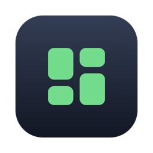
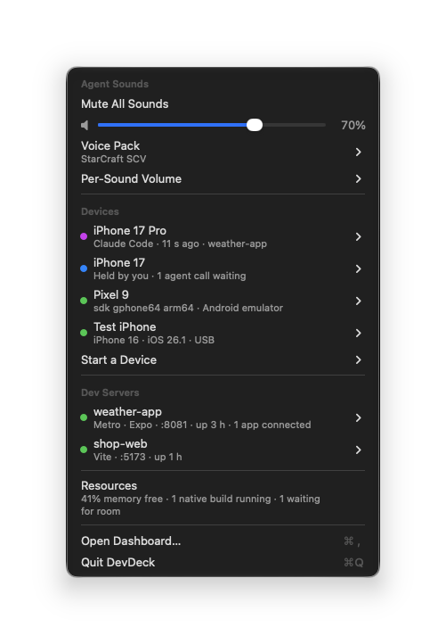
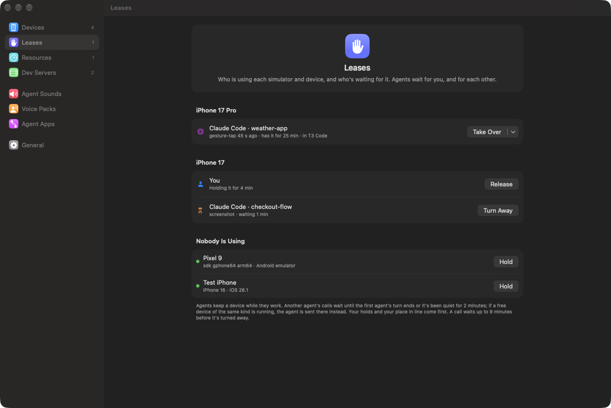
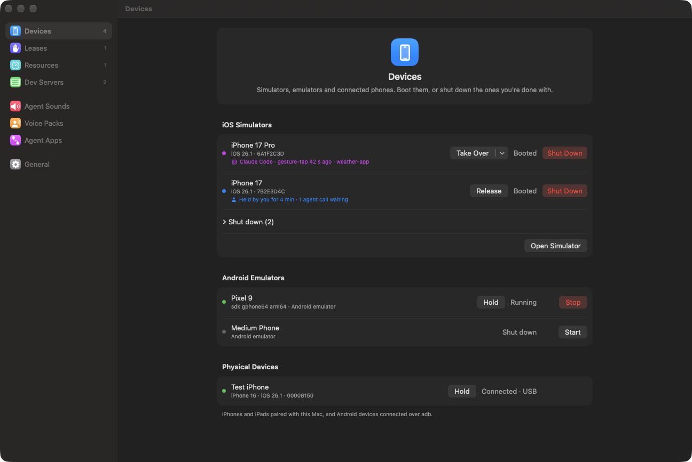
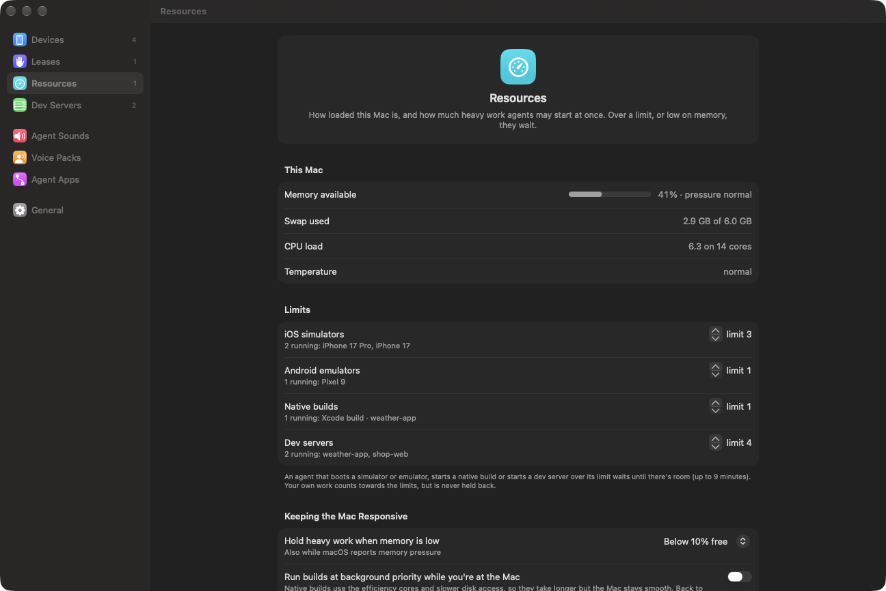
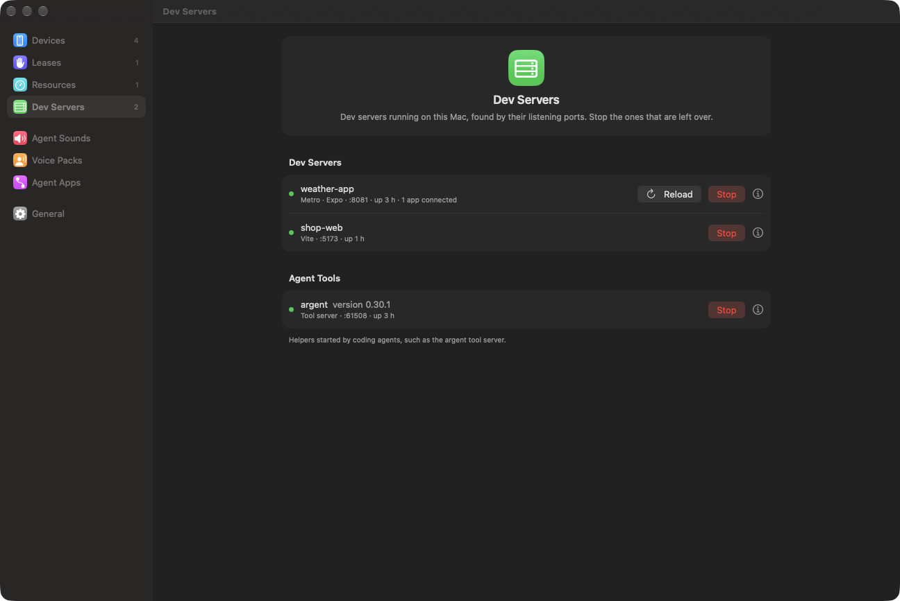
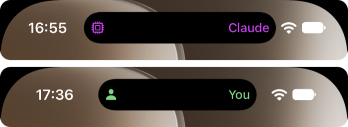

<p align="center">
  
</p>

<h1 align="center">DevDeck</h1>

<p align="center">
  A macOS menu bar app that keeps simulators, dev servers and coding agents in check.
</p>

<p align="center">
  
  
</p>

Coding agents that build and test mobile apps boot simulators, start dev servers and kick
off native builds, often several agents at once, on the same Mac you're working on.
DevDeck shows what's running and lets you stop what's left over. It also tells you which
device an agent is driving, and makes agents take turns: with you, with each other, and
with your Mac's memory.

## Features

- **Devices.** iOS simulators, Android emulators and connected iPhones and Android
  phones in one list. Boot, shut down and start them from the menu.
- **Dev servers.** Finds Metro, Vite, Next.js and other dev servers by their listening
  ports and names them after their project. **Stop** ends the whole process tree, and
  **Reload** reloads the apps connected to Metro, like pressing `r` in its terminal.
- **Agent activity.** See which simulator or device a Claude Code agent is driving, and
  what it last did. The device turns purple.
- **Device leases.** **Hold** a device, **take it over** from an agent, or **join the
  queue** for it. Agents wait for you, and for each other. An agent that finds a device
  busy is sent to a free one of the same kind.
- **On-device markers.** A small companion app shows who's driving a simulator in the
  Dynamic Island (a Live Activity), or as a silent notification on Android emulators.
- **Resources.** Limits on booted simulators, emulators, native builds and dev servers,
  plus a low-memory check: agents wait for room instead of grinding your Mac to a halt.
  It also stops idle Gradle and Kotlin daemons, and can run builds at background
  priority while you're at the Mac.
- **Agent sounds.** Volume, voice packs and per-sound settings for
  [peon-ping](https://github.com/PeonPing/peon-ping), if you use it.
- **Native.** A real macOS menu and a dashboard laid out like System Settings, with
  Liquid Glass on macOS 26.

## Screenshots

| Devices | Resources |
|---|---|
|  |  |

| Dev Servers | Device markers in the Dynamic Island |
|---|---|
|  |  |

## Requirements

- macOS 26 or later, and Xcode 26 or later to build it.
- Optional: the Android SDK for emulators and Android devices,
  [Claude Code](https://claude.com/claude-code) for agent activity and leases,
  [argent](https://github.com/software-mansion/argent) (DevDeck understands its device
  tools), and [peon-ping](https://github.com/PeonPing/peon-ping) for agent sounds.

## Build and install

```bash
git clone https://github.com/michalsek/devdeck.git
cd devdeck
bash scripts/build-app.sh --install   # builds DevDeck.app, copies it to ~/Applications and opens it
```

The first build also builds the companion apps, so it takes a few minutes. To keep macOS
from asking for folder access again after every rebuild, sign with your development
certificate; see [docs/development.md](docs/development.md#signing).

## Getting started

1. Click the menu bar icon for devices, dev servers and resources at a glance. The
   number next to the icon is how many dev servers are running.
2. Choose **Open Dashboard…** (⌘,) for everything else.
3. Turn on **General → Agent Activity → Claude Code**. DevDeck adds hooks to
   `~/.claude/settings.json`, and from then on devices that agents drive are marked.
   If DevDeck isn't running, the hooks do nothing.
4. To keep agents off a device, choose **Hold Device** in its menu, or **Take Over** on
   one an agent is using. Release it when you're done; your hold also ends after you've
   been away from the Mac for a while.
5. Set the limits for heavy work on the **Resources** page.

Codex hooks work the same way but are experimental; Codex asks you to trust them in
`/hooks`.

## Learn more

- [How it works](docs/how-it-works.md): how DevDeck finds things, the lease and queue
  rules, resource limits, device markers and the socket scripts can use.
- [Development](docs/development.md): building, signing, tests, demo mode and the
  project layout.
- [Companion apps](helpers/README.md): the iOS and Android marker apps.
